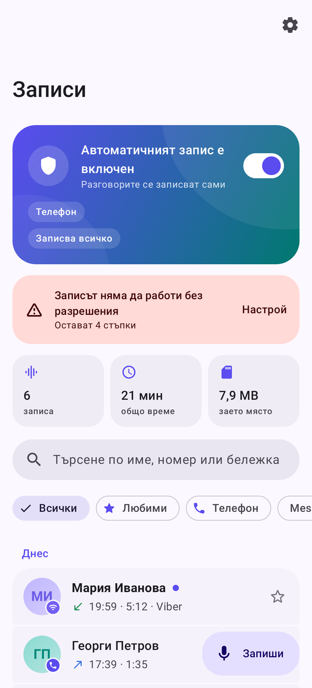
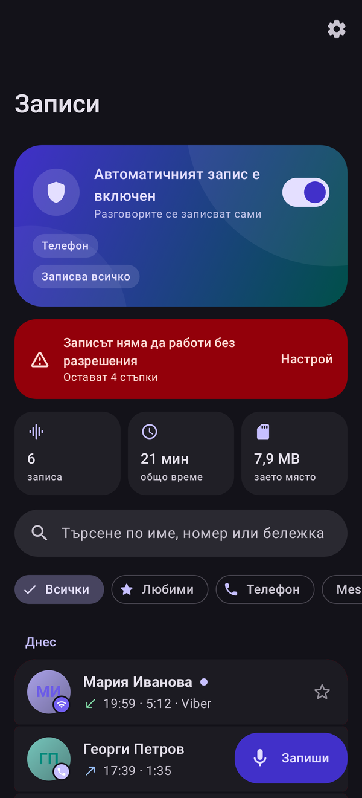
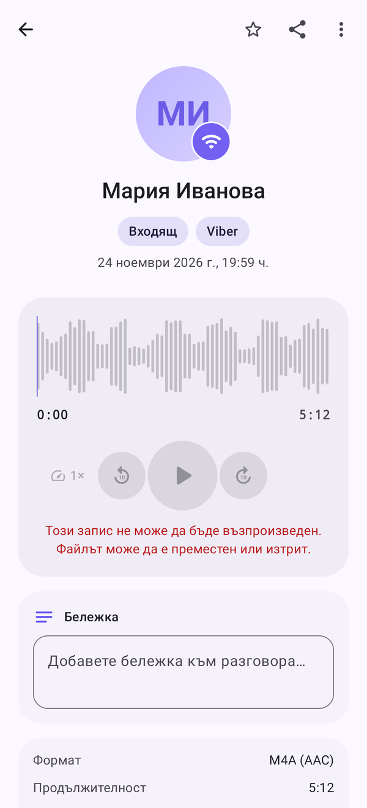
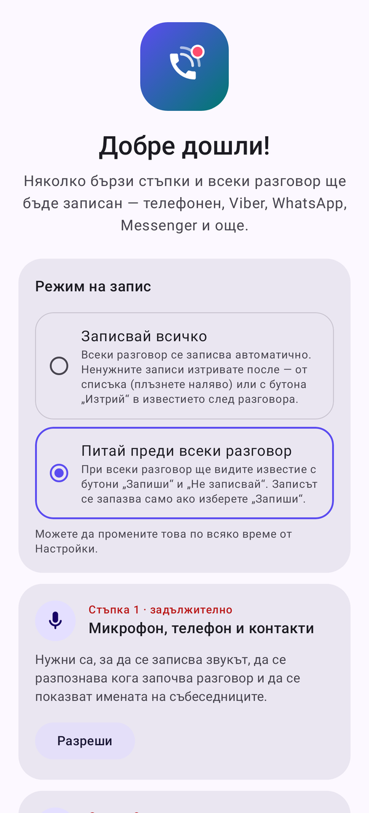

# Запис на разговори

Безплатно Android приложение без реклами за автоматичен запис на разговори. Записва обикновени телефонни обаждания и разговори от **Viber, WhatsApp, Messenger, Telegram, Signal, Skype, Teams, Google Meet, Zoom, Discord, Instagram** и други. Интерфейсът е модерен, с Material 3 и Material You.

<p>
  
  
  
  
</p>

## 📥 Изтегляне

**[Изтеглете последната версия (APK) от страницата Releases](https://github.com/evolutiondevil-coder/Call-Recording/releases/latest)**. Отворете връзката от телефона, натиснете файла `.apk` и го инсталирайте.

## Възможности

- **Автоматичен запис** на телефонни (SIM) и интернет разговори. Можете да изберете кои приложения да се записват.
- **Два режима:**
  - *Записвай всичко.* Всеки разговор се записва, а ненужните изтривате после (плъзгане наляво в списъка, множествен избор или бутон „Изтрий“ в известието след разговора).
  - *Питай преди всеки разговор.* Когато разговорът започне, излиза известие с бутони „Запиши“ и „Не записвай“. Звукът се записва от самото начало, за да не се изгубят първите секунди, но се запазва само ако натиснете „Запиши“.
- **Формати:** M4A (AAC), **MP3**, **AMR-WB**, **AMR-NB** и WAV, в три нива на качество.
- **Усилване на звука** с вграден ограничител, за да не се изкривява.
- **Автоматичен избор на аудио източник.** Ако системата заглуши даден източник, приложението само минава на следващия.
- **Филтри:** всички, само контакти, само непознати номера или **само избрани контакти** (бял списък). Има списък с изключени номера и минимална продължителност.
- **Библиотека:** групиране по дни, търсене по име, номер или бележка, филтри по приложение, любими, бележки, преименуване, споделяне, „Запази като…“, обратно обаждане.
- **Плейър** с вълнова форма, превъртане ±10 s и скорост 0.75×–2×. Записите може да се слушат тихо **през слушалката**, като разговор.
- **Изрязване на запис** без загуба на качество: като нов запис или на мястото на оригинала.
- **Бележка след разговора** направо от известието „Записът е запазен“.
- **Заключване с ПИН** и пръстов отпечатък (или лице). При забравен ПИН се отключва със заключването на екрана на телефона.
- **Съхранение** в паметта на приложението или в избрана от вас папка. Има автоматично изтриване на стари записи; любимите не се трият.
- Бутон в **Бързите настройки** за включване и изключване на автоматичния запис.
- **Светла и тъмна тема** и динамични цветове (Material You).
- **Поверителност:** записите **остават само на телефона**. Не се качват никъде и не се архивират в облака. Интернет се ползва единствено за проверка за нова версия в GitHub.
- **Езици:** български (по подразбиране) и английски, с избор в Настройки → Език.
- **Автоматично обновяване:** при стартиране приложението проверява за нова версия в GitHub, сваля я само и предлага „Инсталирай“.

## Инсталиране

1. Изтеглете APK файла от [Releases](https://github.com/evolutiondevil-coder/Call-Recording/releases/latest).
2. Отворете го на телефона и разрешете „Инсталиране от неизвестни източници“, ако Android попита.
3. Отворете приложението и минете през съветника:
   - **Микрофон, телефон и контакти.** Натиснете „Разреши“.
   - **Услуга за достъпност** (задължителна за Android 10+). Включете „Запис на разговори“.
   - **Достъп до известията.** Нужен е за Viber, WhatsApp, Messenger и др.
   - **Без ограничение на батерията.**

> **Android 13 и по-нови:** ако превключвателят за достъпност или известия е сив („Ограничена настройка“), отворете *Настройки → Приложения → Запис на разговори → ⋮ (горе вдясно) → Разрешаване на ограничени настройки* и опитайте пак. В съветника има бутон, който води директно там.
>
> **Xiaomi / Huawei / Oppo и др.:** включете и „Автоматично стартиране“ за приложението, ако телефонът има такава настройка.

## Как работи и какви са ограниченията

- От Android 10 нататък Google не позволява на обикновени приложения да записват директно линията на разговора. Работещият начин, който ползват и най-известните приложения за запис, е **услуга за достъпност + запис от микрофона**. Гласът ви се записва чисто. Гласът на събеседника се записва през микрофона, затова при **високоговорител** се чува най-добре.
- Някои производители блокират микрофона по време на разговор. Приложението разпознава тих запис, сменя аудио източника автоматично и ако нищо не помогне, ви уведомява.
- Интернет разговорите се разпознават по известието „текущ разговор“ на съответното приложение и по аудио режима на телефона. Гласовите съобщения не се бъркат с разговори.
- Ако процесът бъде спрян по средата на разговор, MP3, AMR и WAV записите се възстановяват при следващото стартиране. M4A не може да се възстанови по технически причини.

## Законова бележка

Записването на разговори може да е ограничено от закона. В България и ЕС уведомете събеседника си и използвайте записите само законосъобразно. Вие носите отговорност за начина, по който използвате приложението.

## Компилиране

Изисквания: JDK 17+ и Android SDK (platform 36).

```bash
./gradlew assembleRelease
```

APK файлът е в `app/build/outputs/apk/release/`.

Тестове (JVM + Robolectric, включително скрийншоти на екраните в `app/build/screenshots/`):

```bash
./gradlew testDebugUnitTest
```

### Нова версия

1. Увеличете `versionCode` и `versionName` в `app/build.gradle.kts` (и опишете промените в `release/RELEASE_NOTES.md`).
2. Качете промените в основния клон.

GitHub Actions сам компилира APK, подписва го с ключа на приложението и го публикува в [Releases](https://github.com/evolutiondevil-coder/Call-Recording/releases). Приложението на телефона забелязва новата версия, сваля я и предлага „Инсталирай“.

### Ключ за подписване

Всяко Android приложение е подписано с ключ. Обновяване се приема само ако е със същия ключ. Файлът на ключа (`signing/call-recorder-release.jks`) е в хранилището, но е **криптиран с парола**. Паролата е само в тайната `SIGNING_PASSWORD` в *Settings → Secrets and variables → Actions* и никога не се вижда в кода. Без нея никой не може да подпише версия на приложението.

За локално подписване създайте `keystore.properties` (в `.gitignore` е) с `storePassword=` и `keyPassword=`.

## Технологии

Kotlin 2.2, Jetpack Compose + Material 3, Room, DataStore, coroutines. Звукът се записва с AudioRecord на отделна нишка с опашка към енкодер (MediaCodec за AAC/AMR и чисто Java LAME, [jump3r](https://git.iem.at/sciss/jump3r), LGPL, за MP3). Поддържа се Android 8.0 – 16 (minSdk 26, targetSdk 36).

```
app/src/main/java/bg/evolution/callrecorder/
├── audio/     запис, ресемплиране, усилване, вълнова форма, енкодери
├── detect/    разпознаване на GSM и интернет разговори, услуги за достъпност и известия
├── service/   контролер на записа, foreground услуга, известия
├── data/      Room база, настройки, файлове, контакти и списък с обаждания
├── tile/      бутон в Бързите настройки
└── ui/        Compose екрани: начало, плейър, настройки, съветник
```
